# SmartChart reference expansion (41–80)

40 additional schematic examples for reference and editorial use. The original desktop catalog retains 40 functional renderers; the additional examples are not data-driven renderers yet. All visualizations are synthetic schematic illustrations, not calibrated observations.

## 41. Ridgeline plot

Overlapping density curves compare distributions. **Application:** ASIC temperature distributions. **Caution:** Use consistent bandwidth.

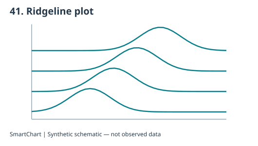

## 42. Q–Q plot

Sample quantiles against theoretical quantiles reveal distribution differences. **Application:** Network latency diagnostics. **Caution:** Do not infer independence.

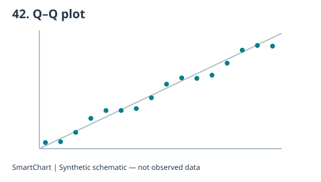

## 43. P–P plot

Empirical and theoretical cumulative probabilities are compared against equality. **Application:** Outage-duration models. **Caution:** Tail differences may be obscured.

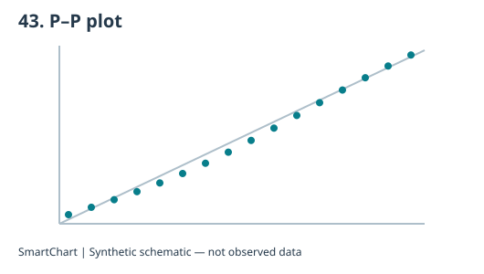

## 44. ECDF plot

A staircase records the fraction of samples at or below a threshold. **Application:** Latency percentiles. **Caution:** Report sample size.

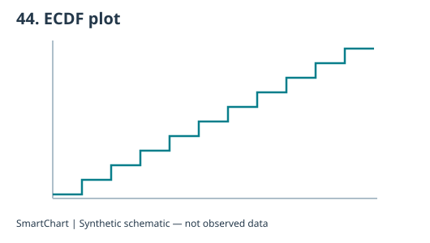

## 45. Forest plot

Points and horizontal intervals compare estimates and uncertainty. **Application:** Benchmark effects by device. **Caution:** Declare interval type.

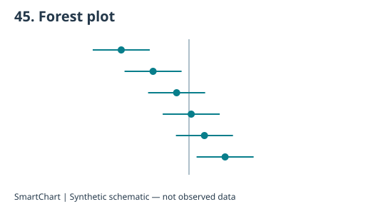

## 46. Error-bar plot

Interval endpoints around estimates show variability or uncertainty. **Application:** Repeated power measurements. **Caution:** Distinguish SD from confidence intervals.

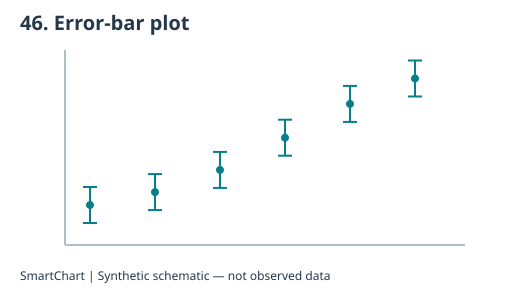

## 47. Residual plot

Observed minus fitted values are plotted against fitted values. **Application:** Power regression diagnostics. **Caution:** Patterns suggest model misspecification.

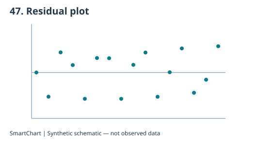

## 48. Autocorrelation plot

Correlations with lagged copies of a series reveal persistence. **Application:** Periodic power demand. **Caution:** Account for nonstationarity.

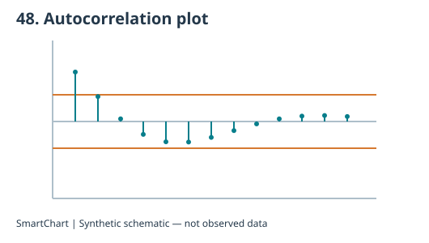

## 49. Partial autocorrelation plot

Lagged correlation after controlling for shorter lags helps identify autoregressive order. **Application:** Telemetry models. **Caution:** Report sampling uncertainty.

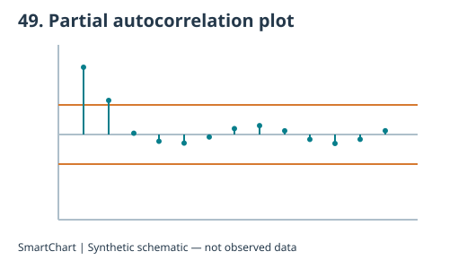

## 50. Lag plot

Observations are plotted against earlier observations. **Application:** Detecting serial dependence. **Caution:** Specify the lag.

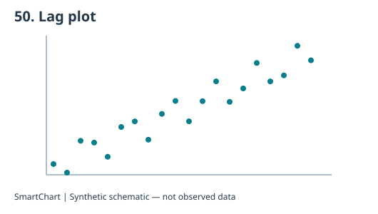

## 51. Bode plot

Gain and phase appear on aligned logarithmic frequency axes. **Application:** Power supply feedback. **Caution:** Specify frequency units.

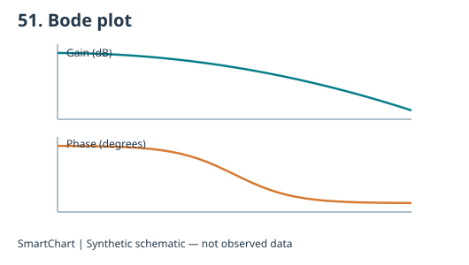

## 52. Nyquist plot

A complex frequency-response trajectory reveals feedback behavior. **Application:** Control-system stability. **Caution:** Interpret encirclements with open-loop poles.

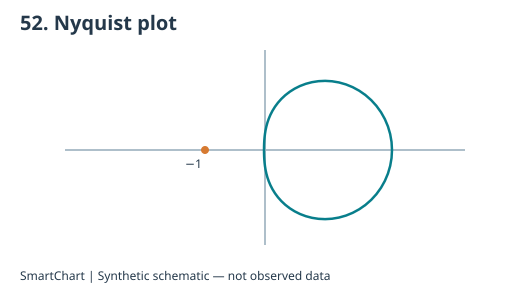

## 53. Smith chart

Complex reflection coefficient maps onto a normalized impedance grid. **Application:** RF matching. **Caution:** Declare reference impedance.

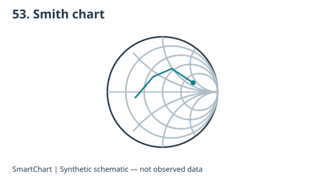

## 54. Nichols chart

Gain in decibels is plotted against phase in degrees. **Application:** Controller margin analysis. **Caution:** Distinguish from Nyquist coordinates.

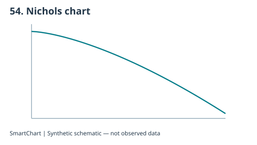

## 55. Root locus plot

Closed-loop poles trace paths as feedback gain changes. **Application:** Regulator stability. **Caution:** Declare gain range and feedback convention.

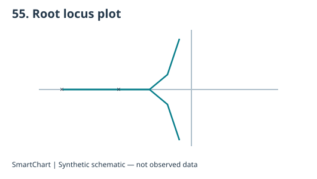

## 56. Spectrogram

Color represents signal power or magnitude by time and frequency. **Application:** Fan vibration. **Caution:** Specify window and overlap.

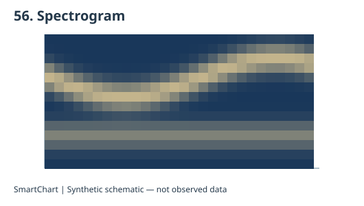

## 57. Power spectral density

Power per frequency bandwidth is plotted against frequency. **Application:** Switching noise. **Caution:** State units and estimator.

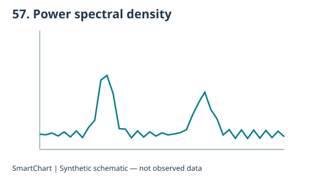

## 58. Quiver plot

Arrows encode vector direction and magnitude at spatial points. **Application:** Rack airflow. **Caution:** Explain arrow scale.

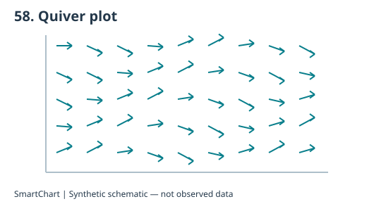

## 59. Streamline plot

Curves follow instantaneous vector-field directions. **Application:** Liquid cooling. **Caution:** Not necessarily particle paths in unsteady flow.

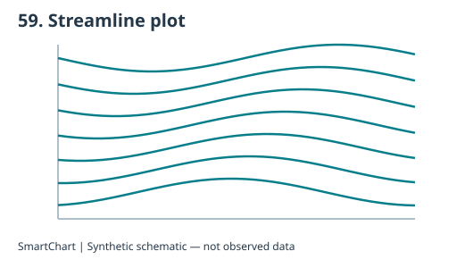

## 60. Contour plot

Lines connect equal scalar values. **Application:** Heat-sink temperature. **Caution:** Label levels and interpolation.

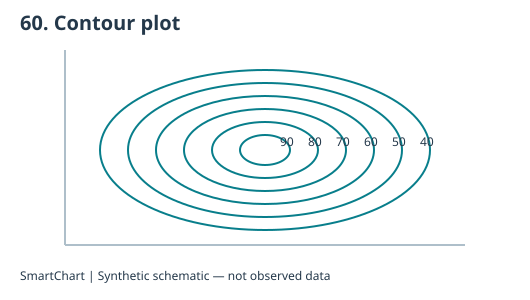

## 61. 3D scatter plot

Points occupy three coordinate axes. **Application:** Throughput, temperature and power. **Caution:** Projection can hide points.

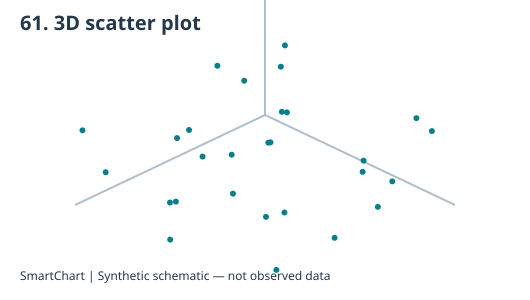

## 62. 3D surface plot

A response surface maps two input variables to one output. **Application:** Voltage-frequency optimization. **Caution:** Distinguish measured and interpolated regions.

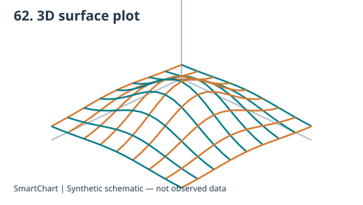

## 63. 3D mesh plot

Connected vertices and faces depict geometry or sampled surfaces. **Application:** Heat-sink geometry. **Caution:** Declare mesh resolution.

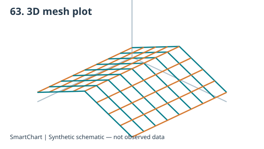

## 64. Isosurface plot

A surface marks equal values in a volumetric field. **Application:** Thermal thresholds. **Caution:** Specify threshold and interpolation.

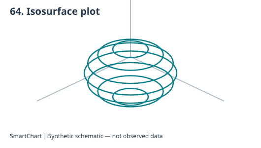

## 65. Ternary plot

Three nonnegative fractions summing to one occupy a triangle. **Application:** Three-source energy mix. **Caution:** Normalize only meaningful totals.

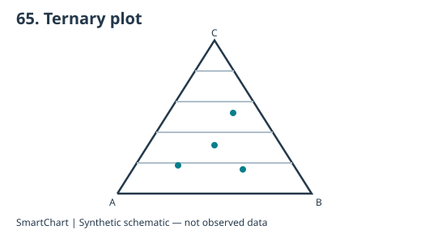

## 66. Parallel coordinates

Each record connects multiple parallel variable axes. **Application:** Mining hardware comparisons. **Caution:** Declare normalization and axis order.

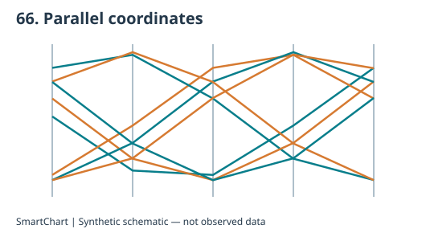

## 67. Scatterplot matrix

A grid displays pairwise scatterplots and diagonal distributions. **Application:** Telemetry correlations. **Caution:** Correlation is not causation.

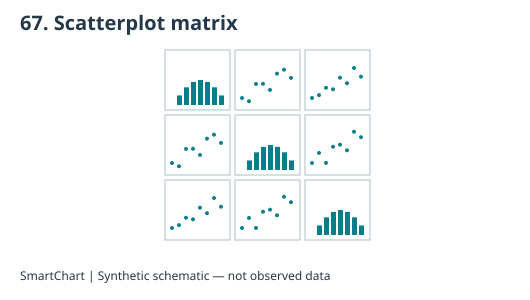

## 68. Carpet plot

Two families of parameter curves form a response grid. **Application:** Pump operating envelopes. **Caution:** Label both parameter families.

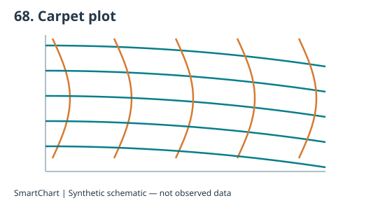

## 69. Polar plot

Angle and radius encode directional values. **Application:** Antenna radiation. **Caution:** Declare angular origin and radial units.

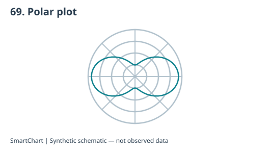

## 70. Icicle chart

Nested rectangles encode hierarchical quantities by depth. **Application:** Data-center budgets. **Caution:** Child totals must reconcile.

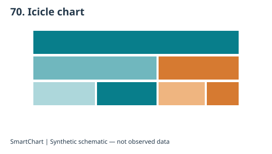

## 71. OHLC bar chart

High-low lines carry left-open and right-close ticks. **Application:** Bitcoin trading ranges. **Caution:** Declare venue and interval.

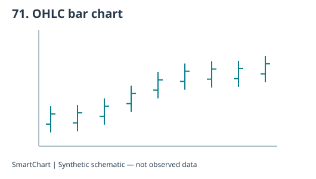

## 72. Fan chart

Nested uncertainty intervals depict forecasts over time. **Application:** Efficiency projections. **Caution:** Scenarios are not probabilities without calibration.

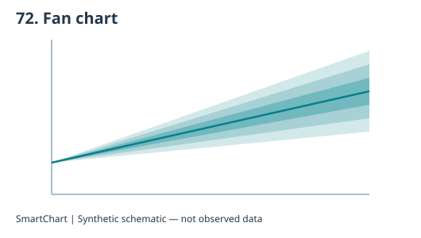

## 73. Horizon chart

Magnitude bands are folded into a compact colored time-series strip. **Application:** Power telemetry. **Caution:** Use consistent band size.

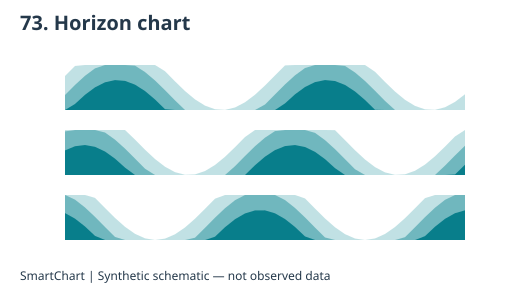

## 74. Streamgraph

Multiple nonnegative series stack around a shifting baseline. **Application:** Energy composition. **Caution:** Baseline complicates absolute comparisons.

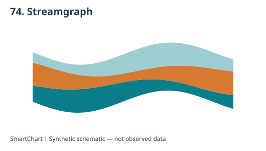

## 75. Drawdown chart

Decline from a running peak is plotted as a percentage. **Application:** Bitcoin risk. **Caution:** Use consistent sampling.

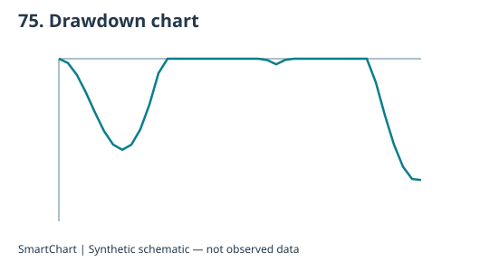

## 76. Order-book depth chart

Cumulative bids and asks are plotted by price. **Application:** Exchange liquidity. **Caution:** Orders may be cancelled.

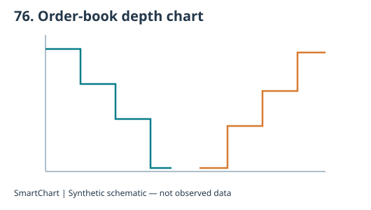

## 77. Load duration curve

Descending power measurements are plotted against exceedance duration. **Application:** Grid and facility sizing. **Caution:** Chronology is lost.

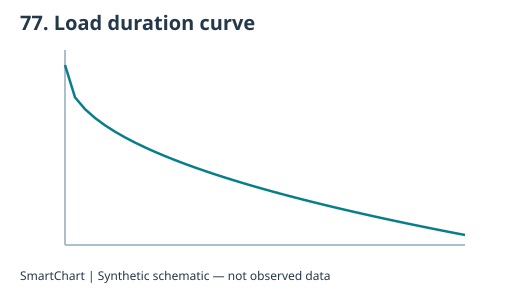

## 78. Learning curve

Unit cost or performance is related to cumulative production. **Application:** ASIC manufacturing economics. **Caution:** Cumulative output is not calendar time.

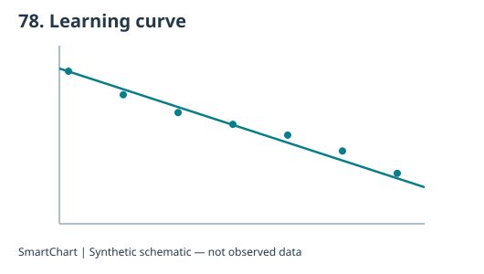

## 79. Pareto frontier

Nondominated options show trade-offs between competing objectives. **Application:** Miner cost versus energy intensity. **Caution:** Declare optimization direction.

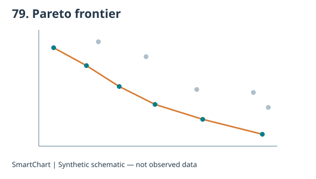

## 80. Network graph

Nodes and edges represent entities and relationships. **Application:** Switch and server topology. **Caution:** Layout distance need not be physical.

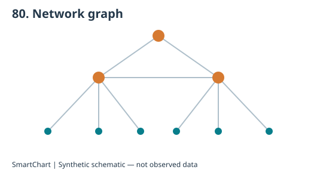

## Further reading
- https://matplotlib.org/stable/gallery/
- https://plotly.com/python/
- https://www.itl.nist.gov/div898/handbook/
- https://python-control.readthedocs.io/en/stable/
